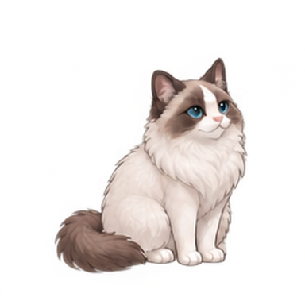

# Umeko Desktop Pets

可直接导入 [Umeko Desktop](https://github.com/umeiko/umeko-desktop) 的桌宠资源。

## 动物

| 宠物 | 预览 | 下载 |
| --- | --- | --- |
| 拉布拉多 |  | [拉布拉多 ZIP](dist/animals/umeko-pet-labrador-1.0.0.zip) |
| 布偶猫 |  | [布偶猫 ZIP](dist/animals/umeko-pet-ragdoll-1.0.0.zip) |
| 罗威纳 |  | [罗威纳 ZIP](dist/animals/umeko-pet-rottweiler-1.0.0.zip) |

每只宠物提供待机、思考、工作、等待、完成、出错六种透明循环动画，以及点击、悬停、拖动和任务结果台词。统一 384×384 画布；使用实际绘制的姿态帧，不通过拉伸身体制造动作。

## 人物

### BanG Dream!

| 宠物 | 预览 | 下载 |
| --- | --- | --- |
| 丰川祥子 / Sakiko Togawa |  | [祥子 ZIP](dist/characters/bang-dream/umeko-pet-sakiko-togawa-1.0.1.zip) |
| 若叶睦 / Mutsumi Wakaba |  | [睦 ZIP](dist/characters/bang-dream/umeko-pet-mutsumi-wakaba-1.0.1.zip) |
| 薇欧拉 / Viola |  | [薇欧拉 ZIP](dist/characters/bang-dream/umeko-pet-viola-1.0.1.zip) |

三人各含六种常规状态及一段稀有待机，共 21 段 **512×512 透明循环 GIF**。动画来自独立 H3 原生视频生成后的绿幕/洋红幕抠像，打包时逐字节保留交付 GIF，不从单张静图制造动作。角色资源位于 `pets/characters/bang-dream/`，美术出处、实际生成提示词和人设依据见 [人物说明](pets/characters/README.md)。

BanG Dream! 人物包 `1.0.1` 将工作状态更新为在实体笔记本电脑上打字，电脑与小桌贯穿整个循环。其余动作与人设保留。

### Hyouka / 冰菓

| 宠物 | 预览 | 下载 |
| --- | --- | --- |
| 千反田爱瑠 / Eru Chitanda |  | [爱瑠 ZIP](dist/characters/hyouka/umeko-pet-eru-chitanda-1.0.0.zip) |

爱瑠 `1.0.0` 包含待机、思考、工作、等待、完成、出错与稀有待机七段 **512×512 透明循环 GIF**。工作时在有支撑的小桌上使用实体笔记本电脑。独立生成的 H3 原生视频经绿幕抠像后交付，包内 GIF 保持原始交付字节。设计图、实际提示词、来源与校验记录保存在 [爱瑠美术目录](art/characters/hyouka/eru-chitanda/)。

### Piapro / 初音未来

| 宠物 | 预览 | 下载 |
| --- | --- | --- |
| 初音未来 / Hatsune Miku |  | [初音 ZIP](dist/characters/piapro/umeko-pet-hatsune-miku-1.0.0.zip) |

初音 `1.0.0` 是已验收的**单待机版**：新造型参考图生成的一段 512×512、39 帧、1.8 秒透明循环 GIF。仅声明 `idle`，其他状态由客户端回退显示待机；不包含旧造型动作，也不提供彩蛋。H3 原生视频经蓝幕抠像后转换为 GIF，保留原生正序帧和交付字节。新图、实际提示词、原片、来源与验收记录见 [初音美术目录](art/characters/piapro/hatsune-miku/)。

### Yuexin Meow / 月薪喵

| 宠物 | 预览 | 下载 |
| --- | --- | --- |
| 月薪喵 / Yuexin Meow |  | [月薪喵 ZIP](dist/characters/yuexin-meow/umeko-pet-yuexin-meow-1.0.0.zip) |

月薪喵 `1.0.0` 包含待机、思考、工作、等待、完成、出错及捂鼻扇风的稀有待机七段 **512×512 透明循环 GIF**，内嵌人设与原创互动台词。工作时使用实体笔记本和带支撑脚的小桌。动作由 MiniMax H3 原生参考图视频生成，绿幕经 CPU 抠像得到透明背景；GIF 保留交付原字节。设计、作者出处、原片、实际提示词与验收校验记录见 [月薪喵美术目录](art/characters/yuexin-meow/yuexin-meow/)。

每个包已内嵌专属 `persona` 和互动台词。Python v0.7.3 支持导入这些动画及彩蛋；人设生效需要支持悬浮小助手 `persona` 字段的新版客户端（当前 `main` 已支持）。

## 导入

1. 下载上表中的单只宠物 ZIP，无需解压。
2. 在 Umeko 中打开 **设置 → Agent → 插件管理 → 桌面小宠物**。
3. 点击导入形象，选择 ZIP，再选中已导入的宠物。

资源使用 `format: umeko-pet`、`version: 1`，ZIP 根目录包含 `pet.json`、许可说明和对应的 GIF/WebP；不含代码或远程依赖。每人一份 ZIP，可直接导入。每个包的校验值见 [SHA256SUMS](dist/SHA256SUMS)。重复导入相同 id 会被宿主拒绝；升级前可先删除旧的自定义形象。

## 预览与重新打包

用任意静态文件服务器打开 [交互预览](preview/index.html)，可以切换动作、查看浅色/深色背景并下载 ZIP。

```bash
python -m pip install -r requirements.txt
python scripts/build_packs.py
python -m http.server 43465 --bind 127.0.0.1
```

仅重新打包人物 GIF、保留动物包原样时，使用 `python scripts/build_packs.py --characters-only`。这一步不重编码 GIF。预览页支持动物、人物、BanG Dream!、Hyouka、Piapro 和 Yuexin Meow 分类，只显示各包实际提供的动作，并支持浅深背景。

生成后用准备好 PySide6 的 Umeko Python 环境验证：

```bash
python scripts/validate_packs.py --desktop-source /path/to/umeko-desktop
```

验证会调用宿主原有的 `import_pack` 和 `QImageReader`，真实解压到临时目录，检查全部动画帧、透明度、循环与格式限制；不会修改用户的形象库。

`art/animals/*/atlas.png` 保存最终原画，制作方式和提示词见 [美术说明](art/README.md)。`catalog.json` 是本仓库的分类和下载索引，不会改变 Umeko 的导入协议。

已验证的导出环境为 Pillow 11.1.0 / libwebp 1.5.0；相同环境下重复导出的 ZIP 校验值一致。更换编码器版本后可能需要更新校验值。

本仓库原创动物资源与工具按 MIT 许可证提供。BanG Dream!、Hyouka、初音未来与月薪喵人物包属于非官方同人改编，原角色与系列权利归相应权利人；具体说明随包附在 `LICENSE.txt`，不以仓库 MIT 许可重新授予原角色权利。
